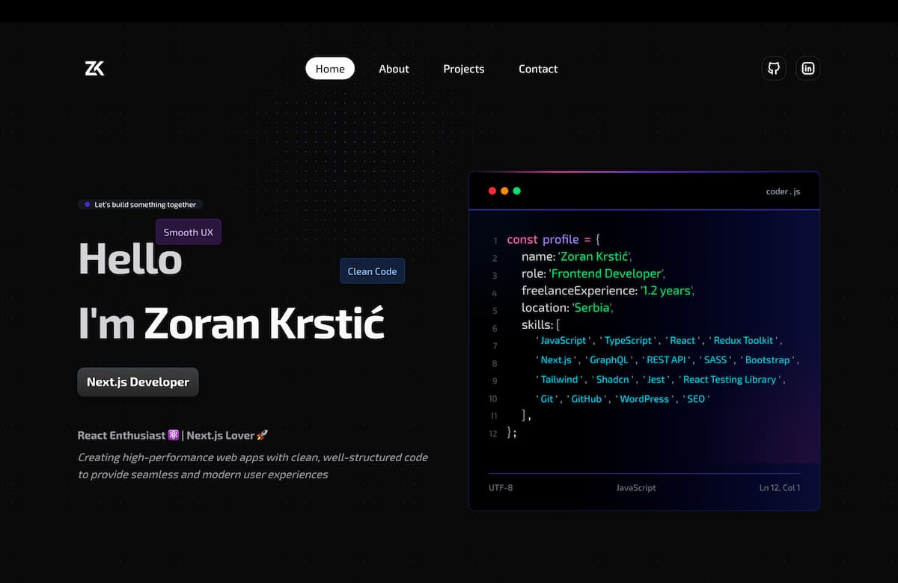

# 🚀 Zoran Krstić – Frontend Developer Portfolio



🔗 **Live Website**: [zkrstic.dev](https://zkrstic.dev)

---

## About

Hi! I'm **Zoran Krstić**, a frontend developer with growing full stack experience, passionate about building clean, performant, and user-friendly web applications.  
This portfolio showcases my work, skills, and the technologies I use.

---

## Technologies Used

### Frameworks and Languages

- ⚛️ **Next.js** – React framework for building fast and scalable web apps.

- 🟦 **TypeScript** – Typed superset of JavaScript for better safety.

### Styling

- 🎨 **Tailwind CSS** – Utility-first CSS framework for rapid UI development.

### UI Component Libraries

- 🧱 **shadcn/ui** – Accessible, reusable UI components built with Tailwind CSS.
- ✨ **magic-ui** – A set of animated UI primitives and transitions.
- 🧬 **ui-aceternity** – A modern collection of animated and interactive UI components.

### Icons

- 🖼️ **Tabler Icons** – Crisp, customizable SVG icons.
- 🧩 **lucide-react** – Beautiful open-source icon library for React.

## Features

- ⚡ **Performance Optimized** – Achieves a 90+ score on Google PageSpeed Insights (mobile) and 97+ on desktop.
- 🧩 **Component-Based Structure** – Built with reusable and maintainable components.
- 🎨 **Modern Design** – Clean, minimal, and elegant UI following current design trends.
- 📱 **Fully Responsive** – Looks great and works smoothly across all devices and screen sizes.
- 🧠 **Accessibility-Focused** – Built with accessibility best practices in mind (90+ Lighthouse score).
- 🎬 **Smooth Animations** – Subtle transitions and animations powered by Framer Motion.
- 📁 **Project Showcase** – Highlights selected real-world and demo projects.
- 📬 **Contact Form** – Easy way to get in touch directly from the site.

### Form handling & validation

- 🧾 **React Hook Form** is used on the client for lightweight, performant form state management and UX (controlled inputs, submission state, error display).
- 🛡️ **Zod** defines a single schema for the contact form which is used for client-side validation (via a resolver) so validation messages are shown immediately to users.
- 🔁 The server re-validates the same schema on submit (defence-in-depth) and additionally applies sanitization, honeypot checks, timing checks and rate limiting before sending notifications. This ensures client-side convenience and robust server-side protection against malformed or abusive requests.

## Security and Anti-Spam Measures

To protect the contact form from spam and abuse, several techniques have been implemented:

🕳️ Honeypot Field – A hidden input that only bots tend to fill. If it’s filled, the submission is flagged as spam.

⏱️ Time-Based Check – If the form is submitted in under 3 seconds, it’s likely a bot and gets rejected.

🧼 Input Sanitization – HTML special characters in the message are escaped, so user input is always rendered as text, preventing cross-site scripting (XSS) or code injection.

🚫 Rate Limiting (Upstash Redis) – Each IP address is limited to a safe number of requests within a defined timeframe. Excessive submissions are temporarily blocked to prevent brute-force or spam attacks.

📏 Length Validation – Messages have a maximum character limit (2,000 characters) to avoid abuse and excessive payloads.

🔒 Empty Input Check – Whitespace-only messages are ignored to ensure all submissions are meaningful.

## Testing

The project has **66 unit and integration tests** written with **Vitest**, focused on the logic behind the site rather than on visual components.

### What is covered

- 📬 **Contact form server action** – schema validation, honeypot, timing check, rate limiting (per-client IP), email delivery and error handling. Redis, Resend and Next.js headers are mocked, so tests never call real services.
- 🧼 **Sanitization** – HTML escaping and length limits, including edge cases found and fixed through tests (escaped characters cut at the length limit, ampersands).
- 🛡️ **Validation schema** – Zod rules and user-facing error messages, including min/max boundaries.
- 🌍 **Location API route** – visitor's capital from the country header, fallbacks and the rate limit response.
- 🧭 **Active section hook** – navigation highlighting in a simulated browser (jsdom) with a fake `IntersectionObserver`.
- 🗂️ **Content data** – unique project titles, `https` links, filled-in text, and that every project and testimonial image exists.
- 🔧 **Smaller helpers** – project filtering, freelance experience calculation, logging in production.

### Workflow

A **Husky** pre-commit hook runs **lint-staged** (ESLint + Prettier on staged files) and the full test suite, so a commit with failing tests or lint errors is rejected.

```bash
npm test            # run all tests once
npm run test:watch  # re-run tests on file save
```
